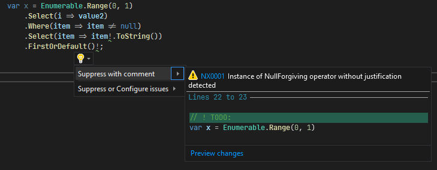
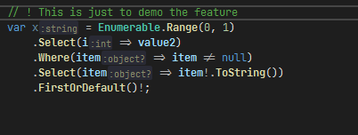
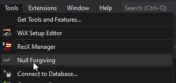
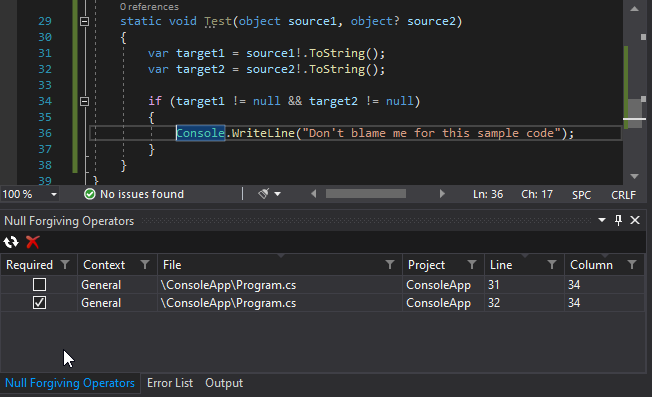

# Nullable Extended
[](https://github.com/tom-englert/Nullable.Extended/actions/workflows/build.yml)
[](https://www.nuget.org/packages/Nullable.Extended.Analyzer/)

## Roslyn tools and analyzers for better coding with nullable reference types

[Nullable reference types](https://docs.microsoft.com/en-us/dotnet/csharp/nullable-references)
are a great feature introduced with C# 8.0 that helps in writing better code.
This project helps to improve the experience when coding with them.

**Three tools are available:**
- The [Roslyn Analyzer](#roslyn-analyzer) (NuGet package) warns about every unjustified usage of the null-forgiving operator, in the IDE and in your builds. Works with any IDE and on CI.
- The [Visual Studio Extension](#visual-studio-extension) lists all usages of the null-forgiving operator in your solution and detects those that are no longer needed.
- The [MCP server](#ai-assistants) supports AI assistants in finding the unjustified usages in large solutions, so they can be fixed.

## Managing null-forgiving operators

Sometimes it is necessary to use the
[null-forgiving operator "!"](https://docs.microsoft.com/en-us/dotnet/csharp/language-reference/operators/null-forgiving)
to suppress a false warning.
However, using too many of them will render the value of nullable checks almost useless.

There are two obstacles:
- The `!` symbol is so unobtrusive, and has multiple meanings in code, that null-forgiving operators are hard to find.
- After some time no one will remember why a null-forgiving operator has been added, or if its usage has been validated,
  so you have to look at the code again and again.

This toolset detects occurrences of the null-forgiving operator and encourages you to annotate them with a justification comment,
so everyone will instantly know why the usage is required.

### Justification comments

A justification comment is one or more single line comments directly above the statement or declaration.
The first comment line must start with `// ! `, followed by the justification text:
```c#
// ! This is only needed to demo the feature
var text = value1!.ToString();
```

---
## AI Assistants

The MCP server `Nullable.Extended.Mcp` lets AI assistants (GitHub Copilot, Claude and other MCP clients) find the unjustified null-forgiving operators
in large solutions, project by project, without a build. The accompanying skill teaches the assistant to fix the code first,
and to use a justification comment only as the last resort.

1. Register the MCP server (.NET 10 SDK or later) in your MCP client, e.g. in `.vscode/mcp.json`; `dnx` downloads and starts it on demand, no installation is needed:
   ```json
   "servers": {
     "Nullable.Extended.Mcp": {
       "type": "stdio",
       "command": "dnx",
       "args": ["Nullable.Extended.Mcp", "--yes"]
     }
   }
   ```
   Alternatively install it as a global tool (`dotnet tool install -g Nullable.Extended.Mcp`) and use `"command": "nullable-extended-mcp"`, see the [documentation](Documentation/McpServer.md).
2. Install the [skill](skills/nullable-extended/SKILL.md) into your project or user profile, with the GitHub CLI or the `skills` CLI:
   ```
   gh skill install tom-englert/Nullable.Extended nullable-extended
   npx skills add tom-englert/Nullable.Extended
   ```
   Without the skill, the server sends a short version of the workflow to the client when it connects.

See the [documentation](Documentation/McpServer.md) for the tools and their parameters.

---
## Roslyn Analyzer

The analyzer generates a warning for every occurrence of the null-forgiving operator that is not annotated with a justification comment,
and provides a code fix that adds the scaffold for the justification comment.

### Installation

Install the [NuGet package](https://www.nuget.org/packages/Nullable.Extended.Analyzer/) in your projects:

```
dotnet add package Nullable.Extended.Analyzer
```

### Usage

A warning is shown for every unjustified occurrence, and a code fix is offered to add the justification comment:



The warning disappears after a justification comment has been added:



### Diagnostics

Occurrences are grouped into four categories, to reflect their different contexts:

| Id | Context |
|---|---|
| NX0001 | Any other usage of the null-forgiving operator. |
| NX0002 | Null-forgiving operator on the `null` or `default` literals at any other statement. |
| NX0003 | Null-forgiving operator inside lambda expressions. |
| NX0004 | Null-forgiving operator on the `null` or `default` literals at init only property assignment. |

General usages (NX0001) can mostly be avoided by cleaning up the code, while inside lambda expressions (NX0003) they are often unavoidable,
so you might want to configure different severity levels for different categories in your `.editorconfig` file:

```ini
[*.cs]
dotnet_diagnostic.NX0001.severity = error
dotnet_diagnostic.NX0003.severity = suggestion
```

---
## Visual Studio Extension

The Visual Studio Extension lists all occurrences of the null-forgiving operator in your solution,
categorizes them like the analyzer does, and even detects those that are still present in code but no longer needed.

### Installation

Install the extension from the [Visual Studio Marketplace](https://marketplace.visualstudio.com/items?itemName=TomEnglert.NullableExtended), 
the [Open VSIX Gallery](https://www.vsixgallery.com/extension/Nullable.Extended.75a92614-c590-4401-b04b-04926c0e21cf) 
or from the [Releases](../../releases) page.

### Usage

Start the tool window from the tools menu:



The tool window shows all occurrences of the null-forgiving operator in your solution and their justification comments.
It also shows if the null-forgiving operator is required to suppress nullable warnings.
If the "Required" column is not checked, the null-forgiving operator might be obsolete and can probably be removed.



- Click the refresh button to scan your solution.
- Double click any entry to navigate to the corresponding source code.

